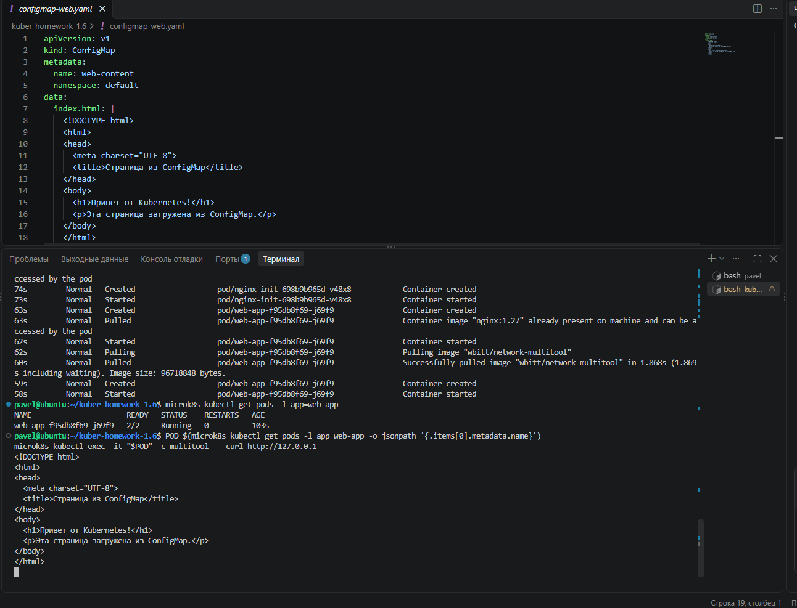
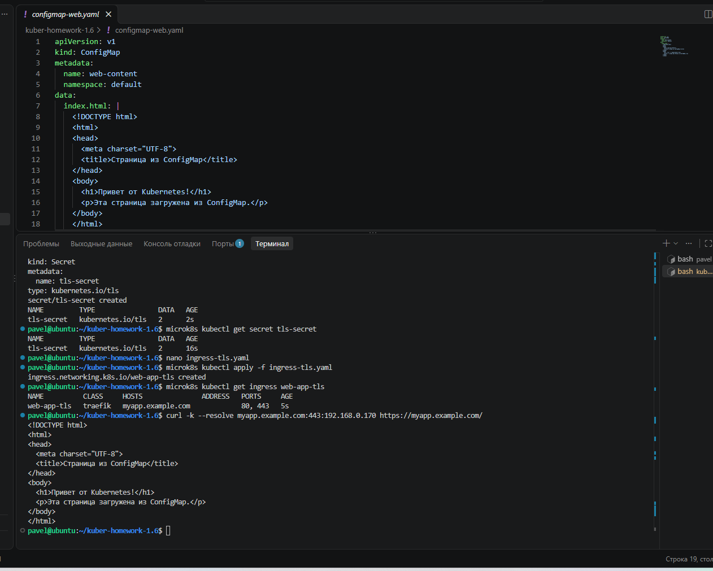
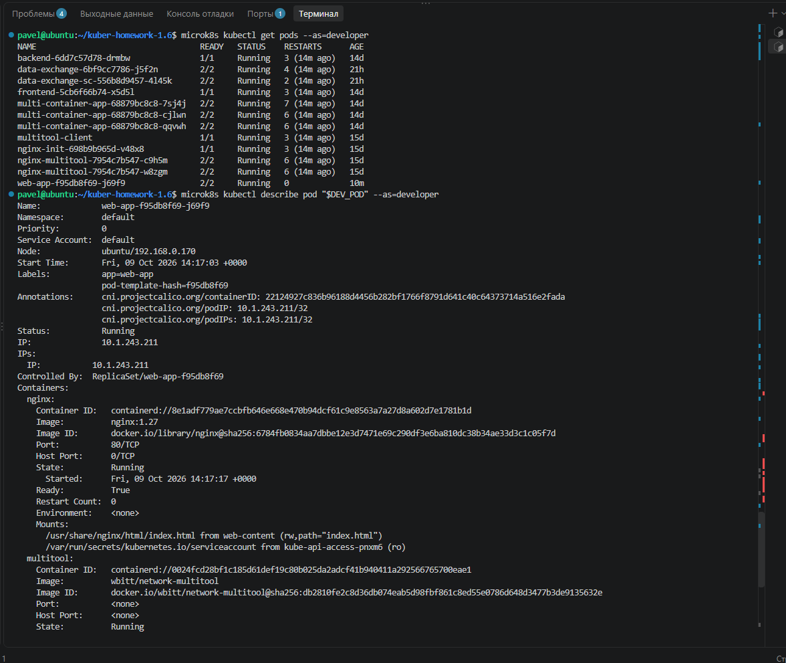

# Домашнее задание к занятию «Настройка приложений и управление доступом в Kubernetes»

## Задание 1. Работа с ConfigMaps

Создан Deployment `web-app` с двумя контейнерами:

- `nginx:1.27`
- `wbitt/network-multitool`

Веб-страница хранится в ConfigMap `web-content` и монтируется в контейнер `nginx` как файл `/usr/share/nginx/html/index.html`.

Для `multitool` используется порт `8080`, чтобы он не конфликтовал с nginx на порту `80`.

Манифесты:

- [deployment.yaml](deployment.yaml)
- [configmap-web.yaml](configmap-web.yaml)

Проверка:

```bash
microk8s kubectl get pods -l app=web-app

POD=$(microk8s kubectl get pods -l app=web-app -o jsonpath='{.items[0].metadata.name}')
microk8s kubectl exec -it "$POD" -c multitool -- curl http://127.0.0.1
```

Результат: Pod запущен в состоянии `2/2 Running`, nginx возвращает страницу, подключённую из ConfigMap.



---

## Задание 2. Настройка HTTPS с Secrets

Сгенерирован самоподписанный TLS-сертификат для имени `myapp.example.com`.

Команда генерации сертификата:

```bash
openssl req -x509 -nodes -days 365 -newkey rsa:2048 \
  -keyout tls.key \
  -out tls.crt \
  -subj "/CN=myapp.example.com"
```

Secret создан из сертификата и приватного ключа:

```bash
microk8s kubectl create secret tls tls-secret \
  --cert=tls.crt \
  --key=tls.key \
  --dry-run=client -o yaml > secret-tls.yaml

microk8s kubectl apply -f secret-tls.yaml
```

Для HTTPS создан Ingress с классом `traefik`, который использует Secret `tls-secret` и направляет запросы на Service `web-app-service`.

Манифесты:

- [secret-tls.yaml](secret-tls.yaml)
- [ingress-tls.yaml](ingress-tls.yaml)

Проверка Ingress:

```bash
microk8s kubectl get ingress web-app-tls
```

Проверка HTTPS:

```bash
curl -k --resolve myapp.example.com:443:192.168.0.170 \
  https://myapp.example.com/
```

Результат: HTTPS работает, а nginx возвращает страницу из ConfigMap.



> `secret-tls.yaml` используется здесь только в рамках учебного задания. В реальной инфраструктуре приватные TLS-ключи не следует хранить в Git в открытом репозитории.

---

## Задание 3. Настройка RBAC

RBAC включён в MicroK8s:

```bash
microk8s enable rbac
```

### Сертификат пользователя developer

Создан приватный ключ и CSR:

```bash
openssl genrsa -out developer.key 2048

openssl req -new \
  -key developer.key \
  -out developer.csr \
  -subj "/CN=developer"
```

CSR подписан CA Kubernetes-кластера:

```bash
sudo openssl x509 -req \
  -in developer.csr \
  -CA /var/snap/microk8s/current/certs/ca.crt \
  -CAkey /var/snap/microk8s/current/certs/ca.key \
  -CAcreateserial \
  -out developer.crt \
  -days 365
```

Проверка сертификата:

```bash
openssl x509 -in developer.crt -noout -subject -issuer
```

Результат:

```text
subject=CN = developer
issuer=CN = 10.152.183.1
```

### Role и RoleBinding

Создана Role `pod-viewer`, разрешающая:

- `get`, `list`, `watch` для `pods`;
- `get` для `pods/log`.

Создан RoleBinding `developer-pod-viewer`, связывающий пользователя `developer` с Role `pod-viewer`.

Манифесты:

- [role-pod-reader.yaml](role-pod-reader.yaml)
- [rolebinding-developer.yaml](rolebinding-developer.yaml)

Проверка прав:

```bash
microk8s kubectl auth can-i get pods --as=developer
microk8s kubectl auth can-i create pods --as=developer
```

Результат:

```text
yes
no
```

Проверка просмотра Pod:

```bash
microk8s kubectl get pods --as=developer
```

Проверка просмотра логов:

```bash
DEV_POD=$(microk8s kubectl get pods --as=developer -l app=web-app -o jsonpath='{.items[0].metadata.name}')
microk8s kubectl logs "$DEV_POD" -c nginx --as=developer --tail=10
```

Проверка запрета удаления Pod:

```bash
microk8s kubectl delete pod "$DEV_POD" --as=developer
```

Результат:

```text
Error from server (Forbidden): User "developer" cannot delete resource "pods" ...
```

Проверка `describe`:

```bash
microk8s kubectl describe pod "$DEV_POD" --as=developer
```

Пользователь `developer` может просматривать Pod, их описание и логи, но не может удалять или создавать Pod.



---

## Итог

В ходе выполнения задания:

- конфигурация веб-страницы вынесена в ConfigMap;
- настроен HTTPS через Kubernetes Secret и Traefik Ingress;
- создан пользователь `developer` с ограниченными правами через RBAC;
- подтверждено, что пользователь может читать Pod и логи, но не может изменять ресурсы.
